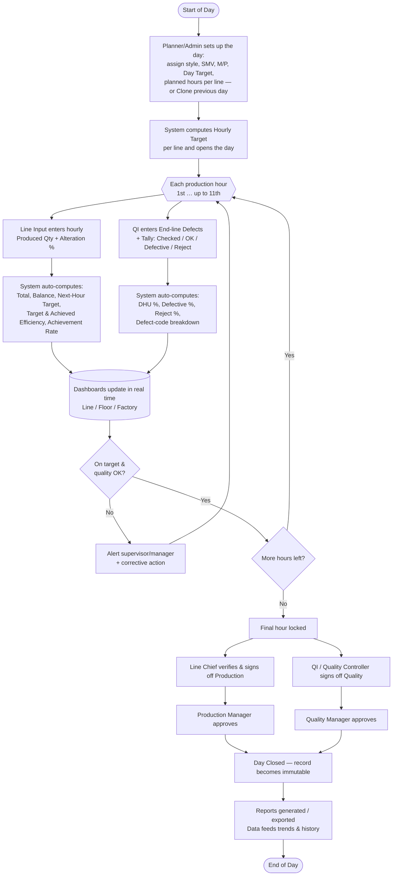

# Software Requirements Specification (SRS)
## Line Digitalization System — Ananta Garments Ltd. / Ananta Sportswear Ltd.

| | |
|---|---|
| **Document** | Software Requirements Specification |
| **Project** | Production & Quality Line Digitalization |
| **Organization** | Ananta Garments Ltd. / Ananta Sportswear Ltd. |
| **Version** | 0.1 (Draft) |
| **Date** | 2026-10-04 |
| **Owner** | ICT / AI Team |
| **Status** | For review |

> This draft is derived from two existing paper/Excel artifacts: the **"Hourly Production Report & Alter % (11 Hours Plan)"** workbook and the **"In Line / End Line Process Quality Control"** form (Q-SEW006-01). Items marked **[ASSUMPTION]** are reasonable defaults to be confirmed; items marked **[DECISION NEEDED]** require a business owner's input before build.

---

## 1. Introduction

### 1.1 Purpose
The purpose of this system is to replace the current Excel-and-paper based line production and quality tracking process with a centralized, real-time, role-based digital platform. The system will capture hourly production output and end-line quality (defect / DHU) data directly at the line, compute efficiency and quality KPIs automatically, and present them on role-specific dashboards for operators, quality inspectors, line chiefs, and management.

### 1.2 Scope
The system covers two tightly linked domains that are today maintained in separate documents:

1. **Hourly Production Tracking** — daily production targets vs. achieved output, per line, per hour, per floor, with efficiency and alteration-rate calculations. (Source: `Hourly Production Formate.xlsx`.)
2. **End-Line / In-Line Quality Control** — per-operator and per-line defect capture, DHU calculation, and defect-category analysis. (Source: paper form `Q-SEW006-01`.)

**In scope**
- Master data management (lines, floors, buyers, styles/orders, operations, operators, defect codes, users).
- Hourly production data entry and automatic KPI computation (hourly target, balance, next-hour target, target/achieved efficiency, hourly achievement rate).
- End-line QC data entry (hourly defects per operation/operator, tally counts) and automatic DHU computation.
- Role-based real-time dashboards (line / floor / factory level).
- Reporting and export (daily, date-range, per line, per buyer/style).
- Role-based access control and audit trail.

**Out of scope (initial release)** — *[DECISION NEEDED]*
- Payroll / operator incentive calculation.
- ERP / planning-system integration (may be a later phase).
- Cutting, washing, finishing, and warehouse modules.
- IoT / automatic machine counters (manual/tablet entry assumed for v1).

### 1.3 Definitions, Acronyms, and Abbreviations

| Term | Meaning |
|---|---|
| **SMV** | Standard Minute Value — standard time (minutes) to complete one garment for a style |
| **M/P** | Manpower — number of operators assigned to a line |
| **DHU** | Defects per Hundred Units = Total Defects × 100 / Total Checked Quantity |
| **Day TGT** | Daily production target (pieces) for a line |
| **Hourly TGT** | Day target distributed across planned production hours |
| **Alter % / Alteration Rate** | Proportion of pieces requiring alteration/rework |
| **Achieved Efficiency** | Actual output efficiency vs. standard time |
| **Target Efficiency** | Planned/target efficiency for the day |
| **QI / QC** | Quality Inspector / Quality Controller |
| **Line** | A sewing production line (labelled A–W in current workbook) |
| **Floor** | Physical floor grouping lines (4th, 5th, 6th, 7th in current data) |
| **Operation** | A single sewing/assembly step performed by an operator |
| **RBAC** | Role-Based Access Control |
| **Buyer** | Customer brand (e.g. H&M, KMART, LC Waikiki, S&G, ZXY, GTGS) |
| **Style / Order** | A specific product/order being produced on a line |

### 1.4 References
- `Hourly Production Formate.xlsx` — current production tracking workbook (one sheet per working date, ~23 lines over 4 floors).
- Form `Q-SEW006-01` — "In Line / End Line Process Quality Control" (DHU capture form).

### 1.5 Overview of document
Section 2 describes the system context and users. Section 3 defines the data model. Section 4 specifies the exact business/calculation rules extracted from the current workbook and form. Section 5 lists functional requirements by module. Section 6 covers dashboards. Sections 7–9 cover interfaces, non-functional requirements, and access control. Section 10+ covers reporting, rollout, and appendices.

---

## 2. Overall Description

### 2.1 Current state (As-Is)
- Each **working day** is a new Excel sheet (e.g. `01-09-2026 (76)`). Line supervisors fill hourly production figures; formulas compute totals, efficiency, and alteration %.
- The **DHU form** is filled on paper at the end-line by the QI, one form per line/process, tallying defects by hour and defect code, then DHU is computed by hand.
- Data is siloed per file/paper, entered once per hour or per shift, and only consolidated manually. There is no live view, no cross-day trend, and reconciliation (production vs. quality) is manual.

**Pain points addressed by this system**
- No real-time visibility of target vs. achieved during the day.
- Manual, error-prone formula entry and transcription.
- No role-based view — everyone shares the same file.
- Hard to trend efficiency/DHU across days, lines, buyers, or styles.
- Production and quality data not linked.

### 2.2 Product perspective
A new, self-contained web application (responsive, usable on shop-floor tablets and office desktops) with a central database. Data is entered once at the source (line/end-line) and flows automatically into KPIs, dashboards, and reports.

### 2.3 Product functions (summary)
1. Capture hourly production per line/style.
2. Capture end-line quality (defects, tally, DHU) per line/operation/operator.
3. Auto-compute all KPIs (efficiency, achievement rate, balance, next-hour target, alteration %, DHU).
4. Present role-based real-time dashboards at line / floor / factory levels.
5. Generate and export reports; retain history for trend analysis.
6. Enforce RBAC and keep an audit trail.

### 2.4 User classes and characteristics (Roles)

| Role | Description | Primary activity |
|---|---|---|
| **Operator Data-Entry / Line Input** | Enters hourly production counts at the line (tablet) | Create/update hourly output |
| **Quality Inspector (QI/QC)** | Records end-line defects and tally per hour | Create/update QC & DHU data |
| **Line Chief / Supervisor** | Owns one or more lines | Verify entries, view line dashboard, set/adjust targets *[DECISION NEEDED: who sets targets]* |
| **Quality Controller** | Owns quality across lines/floor | Review DHU, approve/sign-off quality |
| **Production Manager** | Owns a floor / multiple lines | Floor dashboard, approvals, reports |
| **Quality Manager** | Owns factory-wide quality | Factory DHU dashboard, sign-off |
| **Management / Executive (Viewer)** | Top management | Read-only factory/floor KPIs and trends |
| **Planner / Admin (Master Data)** | Maintains lines, styles, SMV, targets, defect codes, users | Configuration |
| **System Administrator** | IT | User/role management, system config, audit |

> The four signatory roles on the paper form — **Line Chief, Quality Controller, Production Manager, Quality Manager** — map directly to approval/sign-off roles in the digital workflow.

### 2.5 Operating environment — *[ASSUMPTION]*
- **Client:** Modern web browser on Android/iOS tablets (shop floor) and Windows desktops (office). Responsive UI.
- **Server:** Cloud or on-premise web server + relational database.
- **Network:** Factory Wi-Fi/LAN. Must tolerate brief connectivity loss at the line (see 8 — offline/queued entry).
- **Languages:** English UI with Bangla labels/support where helpful *[DECISION NEEDED]*.

### 2.6 Design & implementation constraints
- Must faithfully reproduce the existing calculation logic (Section 4) so results reconcile with current Excel/paper during parallel run.
- Must support the current scale: ~23 lines × 4 floors, up to **11 production hours/day**, up to 20 operations per QC form.
- Working-days calendar (some dates skipped, e.g. no 02, 04, 11, 25 Sep) — the system works per **production day**, not per calendar day.

### 2.7 Assumptions and dependencies
- Hourly data is entered manually (no automatic counters in v1).
- Master data (styles, SMV, manpower, targets) is maintained before/at start of day.
- One line runs one primary style per day in current data, but the model should allow multiple styles per line per day *[DECISION NEEDED]*.

### 2.8 Daily Operational Workflow (Start → End)

This is the end-to-end flow of a single production day in the system — how it **starts**, what repeats **every hour**, and how it **ends** and closes.

**Narrative — who does what, when:**

**① Start of day (setup)**
- Planner/Admin (or Line Chief) opens the new production day and assigns, per line: style/order, SMV, manpower, day target, and planned production hours — or uses **Clone previous day** to pre-fill, then adjusts (FR-5, FR-6).
- The system computes each line's **Hourly Target** and opens the day for entry. The dashboard shows targets with zero progress.

**② During the day (repeats every hour)**
- **Line Input / Supervisor** enters that hour's **produced qty** and **alteration %** at the line tablet (FR-8, FR-9).
- **QI / QC** enters end-line **defects per operation/operator** and the **hourly tally** (checked/OK/defective/reject) (FR-14, FR-15).
- The system instantly recomputes **balance, next-hour target, total, target & achieved efficiency, achievement rate** (production) and **DHU %, defective/reject %, defect-code breakdown** (quality) — Section 4.
- **Dashboards refresh in real time** (Section 6). If a line falls behind target or DHU breaches a threshold, an **alert** fires to the supervisor/manager (FR-27, FR-28), who takes corrective action. The hour is then locked (FR-11); corrections after lock are role-gated and audited.

**③ End of day (close-out)**
- After the final hour is locked, **Line Chief** verifies and signs off production; **QI / Quality Controller** signs off quality.
- **Production Manager** and **Quality Manager** give final approval (the four signatory roles from the paper form) — FR-19.
- The day is **closed and the record becomes immutable** (edits only via the audited correction workflow, FR-20).
- The system generates/export the daily production and QC reports (R-1, R-2) and the day's data feeds the trend dashboards and history.

> This replaces today's flow — writing figures on a sheet during the day, filling the DHU form by hand, and consolidating manually after — with a single continuous digital loop from setup to signed-off close.

---

## 3. Data Model (Core Entities)

> Field names in parentheses map to the current workbook/form columns.

### 3.1 Master data
- **Floor** — id, name (e.g. "4TH FLOOR").
- **Line** — id, label (A–W), line_no (1–23), floor_id, active.
- **Buyer** — id, name (H&M, KMART, LC Waikiki, S&G, ZXY, GTGS, OWN, …).
- **Style / Order** — id, buyer_id, style_name (STYLE), order_no, SMV, status.
- **Operation** — id, name (Name of Operation), standard sequence.
- **Operator** — id, name (Name of Operator), operator_id_no (ID No), assigned_line.
- **Defect Code** — code, description. (Full list in Appendix A — e.g. AB=Uncut Thread, B=Broken Stitch, C=Dirty Spot/Oil Mark, P=Puckering, …)
- **Check Process** — id, name (Name of Check Process; e.g. end-line, in-line).
- **User** — id, name, email, role(s), assigned scope (line/floor/factory).

### 3.2 Production transaction (per Line, per Production Day)
- production_day (date), line_id, style_id, buyer_id.
- SMV (E), manpower/`M_P` (F), day_target (G), working_hours (planned hours for this style, derives Hourly TGT), balance_hours (AC4).
- **HourlyProduction** — for hour 1..11: produced_qty (K..V).
- **HourlyAlteration** — for hour 1..11: alteration_rate (Alter % row).
- Derived (computed, not stored raw): hourly_target (H), balance (I), next_hour_target (J), total_produced (W), target_efficiency (X), achieved_efficiency (Y), hourly_achievement_rate (row 17/32/50/63), avg_alteration (W of Alter% row).

### 3.3 Quality transaction (per Line/Process, per Production Day)
- production_day, line_id, style_id, buyer_id, order_no, check_process_id, inspector_id (Name of QI + ID No), daily_production_qty.
- **OperationDefectRow** — operation_id, operator_id, operator_id_no, defects per hour 1..10, total_defects (sum), defects_pct.
- **DefectByCode** — per defect code counts (tally system).
- **HourlyQCTally** — per hour: hourly_checked_qty, ok_garments_qty, defective_gmts_qty, defects_qty, reject_qty, hourly_dhu_pct, sv_signature.
- Derived: total_defects, total_checked, DHU %, defect-category breakdown.

### 3.4 Workflow / audit
- **Approval** — entity_ref, role, approver_user_id, timestamp, status (as per 4 sign-off roles).
- **AuditLog** — who changed what field, old→new value, when.

---

## 4. Business Rules & Calculations (authoritative)

> These are extracted directly from the current workbook/form and MUST be reproduced exactly. Symbols reference the workbook columns.

### 4.1 Production KPIs
1. **Hourly Target** = `Day Target / Planned Production Hours`
   - In the workbook the divisor varies per line/style (`/8`, `/10`, `/11`, `/13`) = the number of hours planned to complete that day's target. Store this as a per-line/style field, not a constant.
2. **Balance** = `Day Target − Total Produced (to date)` = `G − W`.
3. **Next-Hour Target** = `Balance / Remaining Balance Hours` = `I / AC4`.
4. **Total Produced** = `SUM(hour 1 … hour 11)` = `SUM(K:V)`.
5. **Target Efficiency** = `SMV × Day Target / (M/P × 10 × 60)` = `E × G / (F × 10 × 60)`.
   - *(10 = standard planned hours, 60 = minutes/hour.)*
6. **Achieved Efficiency** = `SMV × Total Produced / (M/P × Actual Working Hours × 60)` = `E × W / (F × AC3 × 60)`.
   - *Actual working hours (`AC3`) is a day-level parameter (9 in the sample).*
7. **Hourly Target Achievement Rate** = `Hour's actual output / Hourly Target` (per floor rollup: `K16/H16`, …).
8. **Floor Subtotal** = sum of line values on that floor; **Grand Total** = sum/average across floors (efficiency averaged, quantities summed).

### 4.2 Alteration (Alter %)
9. **Hourly Alteration Rate** — entered per hour per line (fraction, e.g. 0.04 = 4%).
10. **Average Alteration %** = `AVERAGE(hourly alteration rates)` for the line.

### 4.3 Quality / DHU (from form Q-SEW006-01)
11. **DHU %** = `Total Individual Defects × 100 / Total Checked Quantity`.
12. **Operation Defects %** = `Operation Total Defects / Total Checked (or line qty)` × 100 — *[DECISION NEEDED: confirm denominator]*.
13. **Hourly DHU %** = `Hourly Defects Qty × 100 / Hourly Checked Qty`.
14. **Defective %** = `Defective GMTS Qty / Hourly Checked Qty × 100`.
15. **Reject %** = `Reject Qty / Hourly Checked Qty × 100`.
16. **OK %** = `OK Garments Qty / Hourly Checked Qty × 100`.
17. **Defect-category breakdown** — count/percentage per defect code (AB, B, C, D, …) for Pareto analysis.

### 4.4 Validation rules
- Produced qty, checked qty, defect counts ≥ 0 and integer.
- Hour index within the configured number of hours for the day.
- OK + Defective (+ Reject) reconcile with Checked Qty (warn if mismatch).
- Alteration rate and percentages within 0–100%.
- No duplicate (line + production_day + hour) production entry.
- Required master data (SMV, M/P, target) present before efficiency is shown.

---

## 5. Functional Requirements

### 5.1 Authentication & Authorization
- FR-1 Users log in with email/username + password (SSO optional later).
- FR-2 System enforces RBAC per Section 9; users see only data within their assigned scope (line/floor/factory).
- FR-3 All create/update/delete actions are recorded in the audit log.

### 5.2 Master Data Management (Admin/Planner)
- FR-4 CRUD for floors, lines, buyers, styles/orders (incl. SMV), operations, operators, defect codes, check processes.
- FR-5 Assign styles, SMV, manpower, day target, planned hours, and working hours per line per production day.
- FR-6 Clone a previous day's setup to speed daily setup.

### 5.3 Production Data Entry (Line Input / Supervisor)
- FR-7 Select production day + line; see the day's styles and targets.
- FR-8 Enter produced qty for the current hour (and correct prior hours with permission).
- FR-9 Enter hourly alteration rate.
- FR-10 System auto-computes and displays in real time: hourly target, balance, next-hour target, total, target & achieved efficiency, achievement rate, average alteration %.
- FR-11 Lock an hour after entry window (configurable); edits after lock require supervisor role and are audited.
- FR-12 Offline-tolerant entry: queue locally and sync when connectivity returns *[ASSUMPTION]*.

### 5.4 Quality / DHU Data Entry (QI/QC)
- FR-13 Select production day + line + check process; header auto-fills buyer/style/order from master.
- FR-14 Enter, per operation/operator row, defects per hour (1–10) and defect codes.
- FR-15 Enter hourly tally: checked qty, OK, defective, reject.
- FR-16 System auto-computes total defects, defects %, hourly DHU %, defective/reject/OK %, and daily DHU.
- FR-17 Defect entry by code supports quick tally (tap-to-increment on tablet).
- FR-18 Validation per Section 4.4 with inline warnings.

### 5.5 Approvals / Sign-off
- FR-19 End-of-day (or per-shift) sign-off workflow for the four roles: Line Chief → Production Manager (production), Quality Controller → Quality Manager (quality) — *[DECISION NEEDED: exact sequence]*.
- FR-20 Signed records are immutable except via a correction workflow (audited).

### 5.6 Dashboards (see Section 6)
- FR-21 Real-time, auto-refreshing dashboards at line, floor, and factory scope, filtered by role.

### 5.7 Reporting & Export
- FR-22 Daily production report (reproduces current workbook layout) per line/floor/factory.
- FR-23 Daily QC/DHU report (reproduces form layout) per line/process.
- FR-24 Date-range trend reports: efficiency, DHU, alteration %, achievement — by line/floor/buyer/style.
- FR-25 Export to Excel/PDF; printable layouts matching current forms for the parallel-run period.
- FR-26 Defect Pareto (top defect codes) per line/day/range.

### 5.8 Notifications / Alerts — *[ASSUMPTION / DECISION NEEDED]*
- FR-27 Alert when an hour's output falls below hourly target by a threshold.
- FR-28 Alert when DHU exceeds a configurable limit.
- FR-29 Reminder when an hourly entry is missing past its window.

---

## 6. Dashboard Requirements (Role-based)

> The dashboard is the centerpiece the business asked for: **daily target vs. achieved, hourly update, and efficiency, shown by role.**

### 6.1 Common widgets
- **Target vs. Achieved** (day): day target, produced so far, balance, projected end-of-day, % achieved.
- **Hourly trend**: produced vs. hourly target per hour (bar/line), with achievement rate.
- **Efficiency**: target efficiency vs. achieved efficiency (gauge + trend).
- **Quality**: current DHU %, defective %, reject %, top defect codes (Pareto).
- **Alteration %**: current and trend.

### 6.2 Scope by role
| Scope | Who sees it | Content |
|---|---|---|
| **Line dashboard** | Line Input, Line Chief, QI | One line: live hourly output, efficiency, DHU, next-hour target |
| **Floor dashboard** | Production Manager, Quality Controller | All lines on a floor: ranked by achievement/efficiency/DHU, floor totals |
| **Factory dashboard** | Quality Manager, Management | All floors: factory totals, floor comparison, day/range trends |

- DB-1 Dashboards update in near-real-time as entries are saved (auto-refresh or push).
- DB-2 Each role lands on its default scope; higher roles can drill down (factory → floor → line).
- DB-3 Date selector (single day or range) and filters (buyer, style, floor, line).
- DB-4 Color-coded status (on-target / behind / critical) against thresholds.

---

## 7. External Interface Requirements

### 7.1 User interfaces
- UI-1 Responsive design: tablet-first data-entry screens (large touch targets, tap-to-increment defect tally), desktop-optimized dashboards/reports.
- UI-2 Data-entry grids mirror the familiar Excel/paper layout to ease adoption.
- UI-3 Minimal taps to log an hour; keyboard and numeric-pad friendly.

### 7.2 Hardware interfaces
- HW-1 Shop-floor Android/iOS tablets on factory Wi-Fi *[ASSUMPTION]*.
- HW-2 Optional barcode/QR scan for operator/style selection *[DECISION NEEDED, later phase]*.

### 7.3 Software interfaces
- SW-1 Relational database (e.g. PostgreSQL/MySQL) *[ASSUMPTION]*.
- SW-2 Export to .xlsx and .pdf.
- SW-3 Future: REST API for ERP/planning integration *[later phase]*.

---

## 8. Non-Functional Requirements

| ID | Category | Requirement |
|---|---|---|
| NFR-1 | **Performance** | Dashboard loads < 3 s; KPI recompute on save < 1 s for a line. |
| NFR-2 | **Scalability** | Support current 23 lines × 4 floors and scale to more lines/floors without redesign. |
| NFR-3 | **Availability** | ≥ 99% during factory operating hours; graceful handling of network drops (queued offline entry, then sync). |
| NFR-4 | **Reliability / Integrity** | No data loss on sync; all KPI math reconciles with the current Excel/form during parallel run. |
| NFR-5 | **Security** | RBAC (Section 9); encrypted passwords; HTTPS; session timeout; no sensitive data in URLs. |
| NFR-6 | **Auditability** | Full audit log of edits with user, timestamp, old/new values. |
| NFR-7 | **Usability** | Floor staff productive with < 30 min training; layouts mirror current forms. |
| NFR-8 | **Localization** | English primary; Bangla support where it aids floor staff *[DECISION NEEDED]*. |
| NFR-9 | **Maintainability** | Business constants (working hours, hour count, thresholds) configurable, not hard-coded. |
| NFR-10 | **Backup/Retention** | Daily backups; historical data retained ≥ 2 years for trend analysis *[DECISION NEEDED]*. |

---

## 9. Role-Based Access Control Matrix

| Capability | Line Input | QI/QC | Line Chief | Quality Controller | Production Mgr | Quality Mgr | Management | Admin |
|---|:--:|:--:|:--:|:--:|:--:|:--:|:--:|:--:|
| Enter production (own line) | ✅ | — | ✅ | — | ✅ | — | — | — |
| Enter QC/DHU (own line) | — | ✅ | — | ✅ | — | ✅ | — | — |
| Edit after lock | — | — | ✅ (line) | ✅ (quality) | ✅ (floor) | ✅ (factory) | — | ✅ |
| Approve/sign-off | — | — | ✅ | ✅ | ✅ | ✅ | — | — |
| Line dashboard | ✅ | ✅ | ✅ | ✅ | ✅ | ✅ | ✅ | ✅ |
| Floor dashboard | — | — | ✅ (own) | ✅ | ✅ | ✅ | ✅ | ✅ |
| Factory dashboard | — | — | — | — | view | ✅ | ✅ | ✅ |
| Master data | — | — | — | — | — | — | — | ✅ |
| Reports/export | own line | own line | floor | floor | floor | factory | factory | all |
| User/role admin | — | — | — | — | — | — | — | ✅ |

> *Scopes (own line / floor / factory) are enforced from the user's assignment. Matrix to be confirmed with management.* **[DECISION NEEDED]**

---

## 10. Reports & Exports (detail)
- **R-1 Daily Production Sheet** — same columns as the workbook (Line, Buyer, Style, SMV, M/P, Day TGT, Hourly TGT, Balance, Next-Hr TGT, hours 1–11, Total, Target Eff., Ach. Eff., Alter%), floor subtotals and grand total.
- **R-2 Daily QC/DHU Sheet** — same layout as form Q-SEW006-01 (operations × hours, totals, DHU, tally block, defect-code legend, signatures).
- **R-3 Efficiency Trend** — achieved vs. target efficiency over a date range by line/floor.
- **R-4 DHU Trend & Pareto** — DHU over time + top defect categories.
- **R-5 Achievement Report** — hourly/daily target achievement by line/floor.
- **R-6 Management Summary** — factory KPIs for a chosen period.

---

## 11. Implementation Roadmap (proposed phases)

| Phase | Scope | Outcome |
|---|---|---|
| **P0 — Discovery** | Confirm all [DECISION NEEDED] items, finalize data model & RBAC | Signed-off SRS |
| **P1 — Foundation** | Master data, auth/RBAC, DB | Configurable system shell |
| **P2 — Production module** | Hourly entry + KPIs + line/floor dashboard | Replaces the Excel workbook |
| **P3 — Quality module** | DHU entry + quality dashboard + Pareto | Replaces the paper form |
| **P4 — Reporting & factory dashboard** | Exports, trends, management view | Full reporting parity |
| **P5 — Parallel run** | Run alongside Excel/paper, reconcile | Validation & cut-over |
| **P6 — Enhancements** | Alerts, offline, localization, ERP API | Optimization |

---

## 12. Transition Strategy — From Excel & Paper to Fully Paperless

> Going paperless is a **change-management journey, not a switch**. The goal is zero paper forms and zero manual Excel sheets, reached in controlled stages so the factory never loses visibility and trust is earned before paper is retired.

### 12.1 Guiding principles
- **Parallel before cut-over.** Never remove paper/Excel until the digital numbers reconcile with them for an agreed period.
- **Enter once, at the source.** Data is captured digitally at the line/end-line — not written on paper and re-typed later. Re-keying is the habit paperless must break.
- **Make the digital way the easy way.** Tablet screens that mirror the current forms, with fewer taps than writing, so staff prefer the app.
- **Decommission deliberately.** Paper is retired line-by-line, floor-by-floor only after each proves stable digitally.

### 12.2 Migration stages

| Stage | Name | What happens | Paper/Excel status |
|---|---|---|---|
| 0 | **Baseline & setup** | Load master data (lines, styles, SMV, M/P, targets, operators, defect codes) from existing Excel into the system. Provision tablets and Wi-Fi at the lines. | Paper & Excel still primary |
| 1 | **Shadow entry (pilot line)** | 1–2 pilot lines enter data in BOTH the app and the current form. Compare outputs daily. | Both run; paper is system of record |
| 2 | **Digital-primary (pilot)** | Pilot lines treat the app as system of record; paper kept only as backup. Supervisors read the dashboard, not the sheet. | App primary, paper backup |
| 3 | **Rollout by floor** | Repeat Stage 1→2 floor by floor (4th → 5th → 6th → 7th). Each floor cuts over only after a clean reconciliation window. | Mixed across floors |
| 4 | **Paper retirement** | Once a floor is stable (agreed KPI reconciliation, e.g. ≥ 2 weeks within tolerance), stop printing its forms and freeze its Excel sheet. | Paperless on that floor |
| 5 | **Full paperless** | All floors digital; Excel workbook and printed forms are archived (read-only), no longer maintained. | 100% paperless |

### 12.3 Data migration
- **DM-1** Import current master data (styles, SMV, manpower, buyers, operations, defect codes) from the existing workbook so day-one setup isn't manual.
- **DM-2** Optionally back-load recent historical daily sheets (e.g. last 1–3 months) so trends and dashboards have history from launch *[DECISION NEEDED: how much history]*.
- **DM-3** Keep the old Excel files and paper archives as a read-only historical record; do not delete after cut-over.

### 12.4 Reconciliation & exit criteria (how we know it's safe to drop paper)
A line/floor goes paperless only when, for the agreed parallel period:
- Digital totals (produced, efficiency, DHU, alteration %) match the manual figures within an agreed tolerance (e.g. ≤ 1% variance) *[DECISION NEEDED: tolerance]*.
- All hours are being entered on time, every working day, with no gaps.
- The responsible roles (Line Chief, QI, managers) confirm they rely on the dashboard, not the sheet.
- Sign-off/approval is happening in the system.

### 12.5 People & process (change management)
- **CM-1 Sponsorship** — a management sponsor mandates the move and the cut-over dates.
- **CM-2 Champions** — one tech-comfortable supervisor/QI per floor as the local go-to.
- **CM-3 Training** — short, hands-on, role-specific sessions on the tablet screens; quick reference cards (bilingual if needed).
- **CM-4 Support** — a help channel during rollout; fast fixes for screen/flow friction so staff don't fall back to paper.
- **CM-5 Adoption metrics** — track % of hours entered digitally on time, per line/floor, as the headline paperless KPI.

### 12.6 Risks & mitigations

| Risk | Mitigation |
|---|---|
| Network/Wi-Fi drops at the line | Offline-capable entry that queues and syncs (FR-12); audible save confirmation |
| Staff revert to paper under pressure | Make app faster than paper; champions on floor; management mandate & dates |
| Tablet shortage/damage | Spare devices; allow desktop entry at a floor station as fallback |
| Data mismatch erodes trust | Mandatory parallel run + reconciliation tolerance before retiring paper |
| "Who fixes a wrong entry?" | Clear correction workflow with audit (FR-11, FR-20) defined before cut-over |
| Loss of the familiar Excel layout | Reports (R-1, R-2) reproduce the exact workbook/form layout for continuity |

### 12.7 Definition of "fully paperless"
- No hourly production figures written on paper or kept in manual Excel.
- No printed DHU forms filled by hand.
- All entry, calculation, approval/sign-off, and reporting happen in the system.
- Paper is produced only on demand (e.g. a buyer audit) as a system-generated PDF — never hand-filled.

---

## 13. Future Enhancements (backlog)
- Automatic piece counters / IoT at the line.
- Operator-level efficiency and incentive calculation.
- Predictive end-of-day projection and bottleneck detection.
- ERP / planning / order-tracking integration.
- Mobile app (native) for supervisors.
- WIP and in-line (not only end-line) quality tracking.

---

## Appendix A — Defect Code Legend (from form Q-SEW006-01)

| Code | Defect | Code | Defect |
|---|---|---|---|
| AB | Uncut Thread | P | Puckering |
| B | Broken Stitch | PM | Process Missing |
| C | Dirty Spot / Oil Mark | PL | Pleat |
| D | Down Stitch | R | Raw Stitch |
| E | Raw-Edge Out | RJ | Reject / Damage |
| F | Fabric Defects | RV | Reverse |
| G | Gathering | S | Shading |
| H | Hi-Low / Up-Down | SK | Skip Stitch |
| J | Joint Stitch | SL | Slanted |
| L | Label / Size Mistake | T | Twisting |
| MP | Misplaced | TT | Thread Tension Loose |
| (…) | Measurement / Number Mistake | U | Uneven Stitch |
| O | Open Stitch | (…) | (additional codes as printed) |
| OV | Over / Short Stitch | | Shape |

> *Transcribed from the scanned form; the full code list must be verified against the controlled master and completed in the Admin module.*

## Appendix B — Form → System Field Mapping

| Paper/Excel field | System entity.field |
|---|---|
| Buyer Name | Buyer.name |
| Order No | Style.order_no |
| Style Name | Style.style_name |
| Daily Production Qty | QualityTransaction.daily_production_qty |
| Name of Check Process | CheckProcess.name |
| Name of QI / ID No | User(inspector).name / operator_id_no |
| Line No | Line.line_no |
| Date | *.production_day |
| Name of Operation / Operator / ID No | Operation.name / Operator.name / Operator.operator_id_no |
| Defects 1st–10th Hour | OperationDefectRow.defects[hour] |
| Total Defects / Defects % | derived |
| Hourly Checked/OK/Defective/Reject Qty | HourlyQCTally.* |
| Hourly DHU % / S.V. Signature | derived / HourlyQCTally.sv_signature |
| SMV, M/P, Day TGT, Hourly TGT, Balance, hours 1–11, Total, Eff. | ProductionTransaction.* (Section 3.2) |

---

## Appendix C — Open Questions / Decisions Needed
1. Who sets/adjusts daily targets, and can they change mid-day?
2. Can one line run multiple styles per day (data model already allows)?
3. Exact approval/sign-off sequence for the four signatory roles.
4. Denominator for "Operation Defects %".
5. Localization requirement (Bangla).
6. Offline entry requirement at the line (confirm network reliability).
7. Alert thresholds (efficiency, DHU) and who receives them.
8. Deployment: cloud vs. on-premise; tablet procurement.
9. Data retention period and backup policy.
10. Integration needs with any existing ERP/planning system.

---
*End of document — v0.1 draft for review.*
